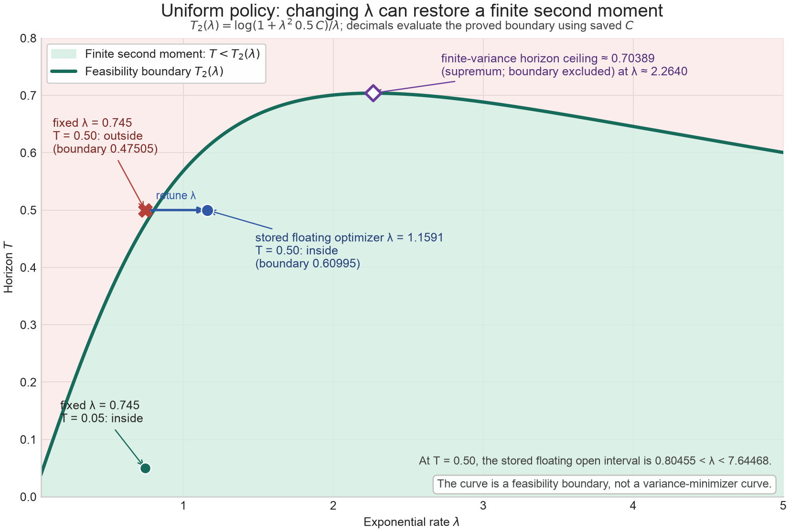

# 延长时间后：原 λ 如何失效，重新选 λ 能救到哪里

**最新认可：2026-10-12。** 用户已理解并认可常数终值、多项式半线性情形下，
从原始 first-step second-moment 递推到精确时间边界的推导。
完整推导见本页末尾的[日期补充](#flat-polynomial-derivation)；
下面先保留 2026-10-05 的 Allen–Cahn 结论与原始证据说明。

2026-10-05 用户认可范围。这里固定原始 derivative-coded Allen–Cahn
估计器、终值 `φ=1/2` 和均匀分支概率 `p=1/2`，只整理旧 λ 的失效与重新选 λ。
后续分支概率优化、改变表示的新算法及其进一步理论留在
`research/branching-mc-theory`，不随本次 main 整合引入。

## 结论

短时间的首项公式给出 `λ≈0.75`，此前使用的数值候选约为 `0.745`。
时间变长后，它先变得不够优，再离开有限方差区域。这个失效是**完整树的
二阶矩变成无穷大**，不等于每棵树都会无限分支，也不等于 PDE 解爆炸。

令

\[
P(v)=\frac9{64}+\frac v{16}+\frac92v^2+6v^3,
\qquad C=\int_0^\infty\frac{dv}{P(v)}\approx1.5301212285131.
\]

此估计器的完整树二阶矩有限，当且仅当

\[
T<T_2(\lambda),\qquad
T_2(\lambda)=\frac{\log(1+\lambda^2 C/2)}{\lambda}.
\]

边界不包含在有限区域内。对 `λ=0.745`，边界为 `T≈0.4750477`。
因此 `T=0.5` 时原 λ 的方差已经无穷大；重新选 λ 可以回到有限区域：

\[
0.8045463<\lambda<7.6446765\qquad(T=0.5).
\]

以上十进制为理论边界的数值计算，不是精确有理端点。λ 太小会使罕见分支的
逆概率权重过大；λ 太大也会放大完整树二阶矩。不能只把 λ 单向增大。

## 为什么边界能由理论求出

非负完整树矩递推给出最小非负矩系统。在这个平坦例子中，消去三角系统中的
辅助变量并使用积分因子，可化为

\[
v'(s)=\frac{e^{\lambda s}}{\lambda p}P(v(s)),\quad v(0)=0,
\qquad\Sigma(v)=\int_0^v\frac{dz}{P(z)},\quad p=\tfrac12.
\]

所以 `Σ(v(T))=(exp(λT)-1)/(λ²p)`；有限解存在恰好要求右侧小于 `C`。
这里还要检查根矩，而不能仅凭某个后代矩爆炸下结论。根二阶矩满足

\[
M_T(\lambda)=e^{\lambda T}\left[\frac14+
p\int_0^{v(T)}\frac{dz}{1+\lambda^2p\Sigma(z)}\right].
\]

当 `v(T)→∞`，被积函数趋于正数 `1/(1+λ²pC)`，故根矩也发散。
在边界及以后，非负递推的单调性给出无穷大。有限区域内一阶矩识别为同一个
PDE 解，故最小化二阶矩等价于最小化方差。

## 重新选择 λ 的实际结果

以下摘自冻结记录；“最优”是完整矩 ODE 的浮点数值优化结果，尚不是精确
全局最优值的有理证书。此表并非 Monte Carlo 样本方差，也非有限深度近似。

| T | 固定 λ=0.745 的方差 | 重新优化的 λ | 重新优化后的方差 |
|---|---:|---:|---:|
| 0.05 | 0.0001511595 | 0.7436702 | 0.0001511276 |
| 0.10 | 0.0008655286 | 0.7473188 | 0.0008653145 |
| 0.25 | 0.01324657 | 0.8211890 | 0.01230648 |
| 0.50 | ∞ | 1.1591179 | 0.14364119 |
| 0.65 | ∞ | 1.6688872 | 0.58206562 |
| 0.70 | ∞ | 2.2070993 | 1.77889674 |

即使每个 T 都重新选 λ，固定均匀分支概率下也只能到
`supλ T₂(λ)≈0.70388997`，且上界不能取到。此数值只约束这里指定的估计器和
采样族，不能宣称所有 PDE 算法都受这个上限限制。

## 如何复查，哪些还没有被证明

- [原始数值记录](lambda-horizon-evidence/raw-results.json)与
  [历史边界证书](lambda-horizon-evidence/boundary-certificates.json)
  按原字节保存；[manifest](lambda-horizon-evidence/manifest.json)记录来源和 SHA-256。
  完整归档包含其他分支概率和后续诊断，那些字段仅保留来源，不扩大本次认可范围。
- [作图脚本](lambda-horizon-evidence/plot_lambda_boundary.py)读取保存的均匀分支
  行并计算理论曲线；没有重跑 Monte Carlo。依赖 numpy、matplotlib，
  从仓库根目录运行 `python docs/research/results/lambda-horizon-evidence/plot_lambda_boundary.py`。
- `python demo/rate_variance.py --T 0.5` 可改变探索性 demo 的时间；
  demo 中的有限深度曲线和有限样本误差棒**不能诊断或证明无穷方差**。
  上面的完整树边界与保存的 ODE 结果才是本页的证据。
- 本次整合不增加 Lean 定理，不把分析推导、浮点 ODE 或画图包装成端到端形式化证明。
  原有 [Lean 覆盖说明](../../../formal/README.md)保持原范围。
- 含 T 的一般最优性方程、更一般 PDE 的安全条件和进一步算法，需另行讲解、
  审查与认可后再整合；不能从此例直接推断。

## 整合来源

以远端 main `629ed59c224216c1104c06d81d625054cf1ad0fe` 为基线，选择
`d1d2f6b1435c7b957cde839a17bffa8078698a95` 的时间参数及诊断作图改动，
并从 `327b582` 的长时间研究归档按路径提取两份 JSON；完整来源提交由 manifest
给出。本页是 2026-10-05 的解释性补充，不改写冻结记录。保留原研究历史及
未提交草稿，不整体合并混合研究提交，不强制推送。

本次验证：隔离工作树中的 `test_rate_variance.py`、`test_rate_optimization.py`、
`test_sampling_tuning.py` 共 49 项通过；使用 `/opt/miniconda3/envs/parabolab/bin/python`，
`PYTHONPATH` 指向该工作树。保存的 JSON 与来源提交逐字节核对，作图经过目视检查。
这不是新一轮 Monte Carlo 实验或 Lean 构建。

## 2026-10-12 补充：从原始矩递推到常数终值的精确时间边界

本节记录用户逐步理解后认可的推导，并扩展前述 2026-10-05 的认可范围。
对应实现已在 main 的 `ce87f46` 中；本次补充解释与导航，不改变算法或冻结证据。
后续概率优化、表示变换及其他研究结果不在本次整合范围。

### 条件、对象与原始递推

考虑一维终值问题

\[
u_t+\tfrac12u_{xx}+f(u)=0,\qquad u(T,x)=a,\qquad x\in\mathbb R.
\]

这里 `a` 是空间常数，`f` 是只依赖 `u` 的实多项式，所有代码共用
`Exp(λ)` 寿命（`λ>0`），采用原始 `SemilinearMechanism` 的均匀分支。
以下有限边界的推导先假设 `deg f=d≥2` 且 `f(a)≠0`；退化情况在末尾说明。

`H_c(t,x)` 是从代码 `c`、当前时间 `t`、位置 `x` 出发的一棵树的随机输出。
**Second moment（二阶矩）**是 `V_c(t,x)=E[H_c(t,x)²]`，即先平方再取平均。
当均值存在时，方差是 `V_c−(E H_c)²`，不能把二阶矩与方差混写。
按[完整树矩定理](../estimator-integrity/notation-and-moment-theorem.md)，
非负截断树矩递增到完整树矩；所用递推解是最小非负解，允许取无穷大。

原始 first-step 公式是

\[
V_c(t,x)=\frac{P_{T-t}[g_c^2](x)}{\bar F(T-t)}
+\sum_{Z\in\mathcal M(c)}\frac1{q_c(Z)}
\int_0^{T-t}\frac1{\rho(s)}
P_s\!\left[\prod_{z\in Z}V_z(t+s,\cdot)\right](x)\,ds.
\]

这里 `P_s[h](x)=E[h(x+W_s)]`，作用于整个孩子矩的乘积，因为孩子共享
分支位置，再各自独立演化。指数寿命给出
`1/\bar F(r)=exp(λr)`、`1/ρ(s)=exp(λs)/λ`。
原机制（系数包含在代码中）为

\[
\begin{aligned}
\mathrm{Id}&\longrightarrow(f^\ast), &&q=1,\\
D_x&\longrightarrow((f')^\ast,D_x), &&q=1,\\
h^\ast&\longrightarrow(f^\ast,(h')^\ast)
\quad\text{或}\quad(D_x,D_x,(-\tfrac12h'')^\ast), &&q=\tfrac12.
\end{aligned}
\]

因此根节点的孩子是 `f*`，不能替换成两个 `Id` 孩子。

### 为什么空间变量消失，以及为什么 D_x 的整个二阶矩为零

把两棵树的起点从 `x` 换成 `x'`，配对使用相同寿命、分支选择和布朗增量，
只会把所有位置平移 `x'−x`。叶值分别为 `a`、`f⁽ᵏ⁾(a)` 或 `φ'=0`，
都与位置无关；逆概率权重也不依赖位置。因此配对的整棵树输出相同，
所有 `V_c(t,x)` 均不依赖 `x`。这是依靠全部上述条件得到的性质；
`P_s` 本身不会把任意函数变成常数。它对已空间恒定的矩取平均才保持原值。

`φ'=0` 单独只能消掉 `V_{D_x}` 递推的终端项：

\[
V_{D_x}(t,x)=e^{\lambda(T-t)}P_{T-t}[(\phi')^2](x)
+\frac1\lambda\int_0^{T-t}e^{\lambda s}
P_s[V_{(f')^\ast}(t+s,\cdot)V_{D_x}(t+s,\cdot)](x)\,ds.
\]

要证明整个二阶矩为零，还需用分支结构：每个 `D_x` 节点都保留一个
`D_x` 孩子。有限时间、固定有限率、每次至多三个孩子的树几乎必然有限。
沿该孩子向下必然到达一个 `D_x` 叶子，其值为 `φ'=0`；乘积沿链向上传播，
于是 `H_{D_x}=0` 几乎必然，进而 `V_{D_x}=0`。
这是逐棵树的零，不是从 `E H_{D_x}=0` 错推二阶矩为零。
即使其他代码的矩发散，包含该零子树的分支样本仍逐棵为零。
**原有两个分支标签的概率仍为 `1/2`，不把剩余标签重新归一化为 1。**

### 保留当前时间，再明确换成剩余时间

根节点公式首先简化成

\[
V_{\mathrm{Id}}(t)=a^2e^{\lambda(T-t)}
+\frac1\lambda\int_0^{T-t}e^{\lambda s}V_{f^\ast}(t+s)\,ds.
\]

定义剩余时间 `r=T−t`，以及

\[
R(r):=V_{\mathrm{Id}}(T-r),\qquad
B_k(r):=V_{(f^{(k)})^\ast}(T-r).
\]

等待 `s` 后，当前时间是 `t+s`，剩余时间是 `T−(t+s)=r−s`，所以

\[
\begin{aligned}
R(r)&=a^2e^{\lambda r}
+\frac1\lambda\int_0^r e^{\lambda s}B_0(r-s)\,ds,\\
B_k(r)&=f^{(k)}(a)^2e^{\lambda r}
+\frac2\lambda\int_0^r e^{\lambda s}B_0(r-s)B_{k+1}(r-s)\,ds.
\end{aligned}
\]

第二式的 `2` 来自 `1/q=2`，根节点没有这个因子。
`f⁽ᵈ⁺¹⁾≡0` 对应零代码，所以 `B_{d+1}=0`。

### 积分因子、变量替换与逐阶积分

令 `G_k(r)=exp(−λr)B_k(r)`。把上式乘 `exp(−λr)`，指数并入第二个孩子：

\[
G_k(r)=f^{(k)}(a)^2+
\frac2\lambda\int_0^r B_0(r-s)G_{k+1}(r-s)\,ds.
\]

换积分变量 `τ=r−s`，则 `dτ=−ds`，上下限由 `(0,r)` 变成 `(r,0)`；
翻转上下限后得到

\[
G_k(r)=f^{(k)}(a)^2+
\int_0^r\frac2\lambda B_0(\tau)G_{k+1}(\tau)\,d\tau.
\]

这里下标没有变化，也没有把 `r−s` 直接当作原来的 `s`。
所有阶数都有相同因子 `2B_0/λ`，于是定义它的累计量

\[
z(r):=\frac2\lambda\int_0^r B_0(\tau)\,d\tau,
\qquad G_k'(r)=z'(r)G_{k+1}(r).
\]

由于 `f(a)≠0`，在有限解区间 `B_0>0`、`z'>0`。为明确区分自变量，
写 `\widehat G_k(z)=G_k(r(z))`。链式法则与初始值给出

\[
\frac{d\widehat G_k}{dz}=\widehat G_{k+1},\qquad
\widehat G_k(0)=f^{(k)}(a)^2,
\qquad
\widehat G_k(z)=f^{(k)}(a)^2+\int_0^z\widehat G_{k+1}(v)\,dv.
\]

从最高阶 `\widehat G_{d+1}=0` 往低阶逐次积分。例如三次多项式：

\[
\begin{aligned}
\widehat G_3(z)&=f'''(a)^2,\\
\widehat G_2(z)&=f''(a)^2+f'''(a)^2z,\\
\widehat G_1(z)&=f'(a)^2+f''(a)^2z+\tfrac12 f'''(a)^2z^2,\\
\widehat G_0(z)&=f(a)^2+f'(a)^2z+\tfrac12 f''(a)^2z^2
+\tfrac16 f'''(a)^2z^3.
\end{aligned}
\]

一般地，

\[
G_0(r)=Q(z(r)),\qquad
Q(z):=\sum_{k=0}^d\frac{f^{(k)}(a)^2}{k!}z^k.
\]

`Q` 是普通多项式，与空间平均算子 `P_s` 区分；上方历史记录的 `P(v)`
以及实现中的 `P(v)` 指的也是这个多项式。
于是 `B_0(r)=exp(λr)Q(z(r))`，并且

\[
z'(r)=\frac{2e^{\lambda r}}\lambda Q(z(r)),\qquad
\int_0^{z(r)}\frac{dw}{Q(w)}=\frac{2(e^{\lambda r}-1)}{\lambda^2}.
\]

### 为什么 z 的发散时间就是根节点的二阶矩边界

`Q` 的系数非负，常数项为正，最高次为 `d≥2`，所以

\[
0<K:=\frac12\int_0^\infty\frac{dw}{Q(w)}<\infty.
\]

有限 `z` 对应的积分严格小于 `2K`；积分随 `z` 严格增加，只有
`z→∞` 才趋于 `2K`。因此当剩余时间递增到

\[
r_*:=\frac{\log(1+K\lambda^2)}\lambda
\]

时，隐式关系迫使 `z(r)→∞`。对每个 `r<r_*`，存在唯一有限的 `z(r)`，
逐阶公式给出有限的导数代码矩，与最小非负矩解一致。

还必须核对根节点，不能只凭辅助变量或后代矩爆炸下结论。换变量后的根公式是

\[
R(r)=a^2e^{\lambda r}+
\frac1\lambda\int_0^r e^{\lambda(r-\tau)}B_0(\tau)\,d\tau.
\]

由 `B_0≥0` 和 `1≤exp(λ(r−τ))≤exp(λr)`，

\[
\boxed{a^2e^{\lambda r}+\frac{z(r)}2
\ \le R(r)\le\ e^{\lambda r}\left(a^2+\frac{z(r)}2\right).}
\]

有限时间内，`z` 有限当且仅当根二阶矩有限。特别地，`r↑r_*` 时根矩
也趋于无穷。这里平坦非负递推的有限深度迭代随 `r` 单调增加，完整树矩
亦然，因此边界处及以后都为无穷大。这就得到精确结论

\[
\boxed{
V_{\mathrm{Id}}(t,x)<\infty
\quad\Longleftrightarrow\quad
T-t<T_2(\lambda),\qquad
T_2(\lambda)=\frac{\log(1+K\lambda^2)}\lambda.
}
\]

图中从 `t=0` 出发，故纵轴就是 `T`。边界不包含在有限区域。
本节刻画的是二阶矩；对任意多项式，不因 PDE 解有限就额外断言树的均值存在。
讨论 PDE 方差时仍须在相应条件下识别均值。

### 五个图的对应关系与证据限制

Allen–Cahn 的 `f(u)=u−u³`、Fisher–KPP 的 `f(u)=u−u²` 分别给出

\[
\begin{aligned}
Q_{\mathrm{AC},a}(z)&=(a-a^3)^2+(1-3a^2)^2z+18a^2z^2+6z^3,\\
Q_{\mathrm{KPP},a}(z)&=a^2(1-a)^2+(1-2a)^2z+2z^2.
\end{aligned}
\]

前四个图分别用 AC 的 `a=0.5,0.3`、KPP 的 `a=0.5,0.2` 计算 `K`。
例如 AC 的 `a=0.5` 给出 `Q(z)=9/64+z/16+(9/2)z²+6z³`，
`K≈0.765060614`；KPP 的 `a=0.5` 有 `K=π/√2`。
这些是由非线性与终值确定的常数，不是拟合参数。

第五个图是**另一个机制**：标准二叉控制 `Id→(Id,Id)`、`f(u)=u²`、`φ=1`。
它的矩满足 `M'=λM+M²/λ, M(0)=1`，得到同形边界但 `K=1`。
不能把这个二叉根递推冒充前四个图的原始 derivative-coded 机制。

- 若 `f(a)=0`，`H_{f*}=0` 几乎必然，根矩为 `a²exp(λr)`，无有限时间边界；
  若 `deg f≤1`，同样无有限时间二阶矩爆炸。这些情况不使用上面的有限 `K` 假设。
- 非常数终值、空间相关系数、非均匀提议或非多项式 `f` 需要重新推导；
  不能把某个起点的 `φ(x)` 代入本公式就声称得到空间波的边界。
- [实现](../../../parabolab/time_lambda.py)、[五例 demo](../../../demo/time_lambda.py)
  和[测试](../../../tests/test_time_lambda.py)来自 `ce87f46`。
  用 `python demo/time_lambda.py --T 0.5` 画理论边界和参考水平线。
  `--T` 不改变边界函数，也不做最优方差的 λ 搜索。
- 解析公式在上述条件下精确；`K` 的一般积分值与图中端点是浮点近似。
  demo 的终值抽样检查只排除显然不平坦的数据，不能证明全空间恒定；调用者须保证条件。
  有限导数列表还须确实由同一个多项式的逐阶导数组成，并在列表之后恒为零；
  实现没有符号证明调用者提供的函数满足这些条件。
- `ce87f46` 集成时相关 time-lambda/rate-variance 测试共 16 项通过；这是历史验证记录。
  本次仅补全已讲解的数学证明与索引，不重跑 Monte Carlo、不增加 Lean 定理，
  不把图、数值测试或此文字推导称为端到端形式化证明。
